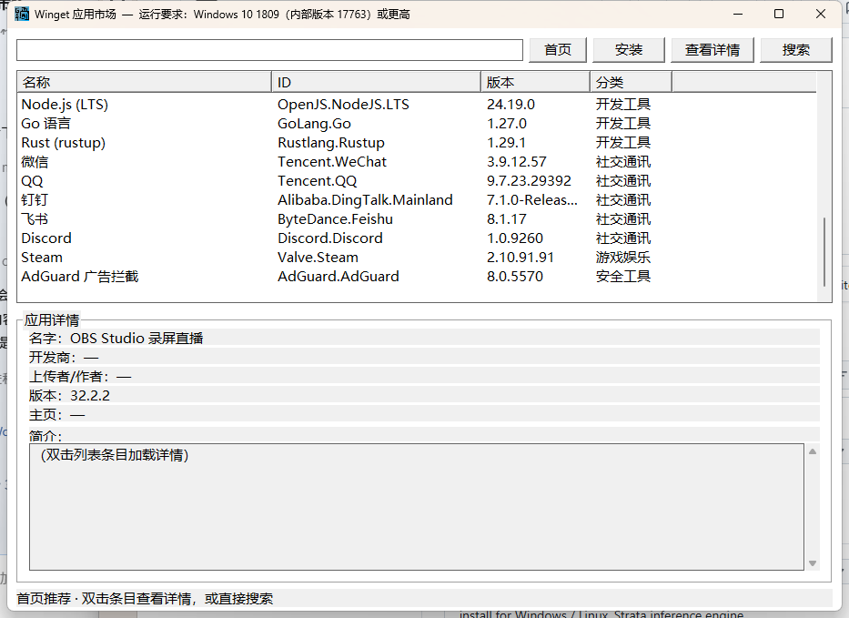

# Winget 应用市场（WingetStore）

> ⚠️ **AI 生成声明**：本项目由 AI 助手（WorkBuddy Agent）根据用户功能需求自动生成，源码（`main.c` 等）未经过人工逐行审校，仅做基础功能验证。如需修改，请自行承担风险。

一个基于 **winget** 的极简图形化 Windows 应用市场。单文件 `.exe`，纯 C + Win32 API，无 Web、无多余依赖。



## 功能

- **首页推荐**：启动即显示 29 款常用应用（浏览器、办公效率、影音直播、开发工具、社交通讯、游戏娱乐、安全工具），按分类展示，版本号后台自动刷新。
- **搜索**：输入应用名，调用 `winget search` 显示结果。
- **应用详情**：双击列表条目，显示名字、开发商、上传者/作者、版本、主页、简介。
- **一键安装**：调用 `winget install` 打开独立命令窗口，结束后窗口暂停，方便查看结果。
- **系统版本检查**：启动时通过 `RtlGetVersion` 检测系统版本，若低于 Windows 10 1809（内部版本 17763）会给出提示。

## 系统要求

- Windows 10 1809（内部版本 **17763**）或更高版本。
- 已启用 `winget`（通常 Windows 10 1903+ / Windows 11 默认包含）。

## 使用

1. 下载 `WingetStore.exe` 并双击运行。
2. 在搜索框输入应用名（如 `7zip`）后按回车，或点击「搜索」。
3. 双击列表条目加载详情；选中条目后点击「安装」即可拉起 winget 安装窗口。
4. 搜索后点击「首页」可回到推荐列表。

## 编译

需要 **TinyCC（tcc）** 或其他支持 Win32 API 的 C 编译器。项目已内置一份便携版 tcc（`tools/tcc/`）。

```bat
tools\tcc\tcc.exe -m64 -mwindows -Itools\tcc\include\winapi main.c -o WingetStore.exe -luser32 -lgdi32 -lcomctl32
```

> 注意：`icon_data.c` 由 `tools/icon_raw.py` 从图标 PNG 生成，已包含在源码中，常规编译无需重新生成。

## 文件说明

| 文件/目录 | 说明 |
|-----------|------|
| `main.c` | 主程序源码（含首页推荐、搜索、详情、安装） |
| `icon_data.c` | 窗口图标资源数据（由图标生成脚本产出） |
| `WingetStore.exe` | 编译好的单文件可执行程序 |
| `tools/` | 编译器与图标生成辅助脚本 |
| `docs/screenshot.png` | 程序截图 |
| `LICENSE` | MIT 许可证 |

## 许可证

[MIT](LICENSE)
